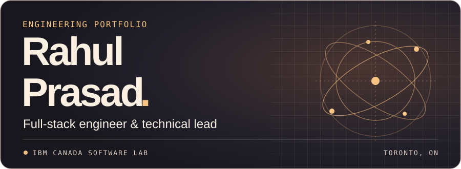
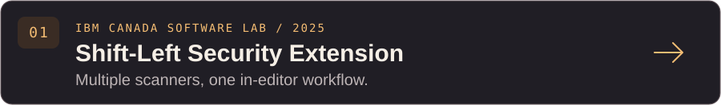
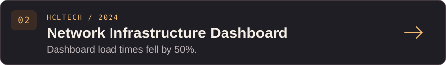
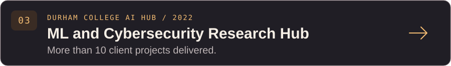
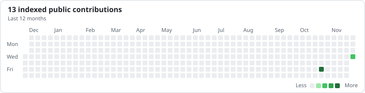
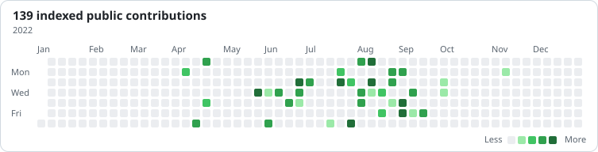

      

# Secure tools for the people who build

I build secure developer tools at **IBM Canada Software Lab** and lead the engineers who make them. I stay close to the code, from React and TypeScript interfaces to Python services, background jobs, and real-time feedback. Across IBM and HCL, I’ve managed teams of **5–10** and helped interview and hire **seven** team members.

[Explore my experience →](https://myportfolio-3eo.pages.dev/about#experience) · [Get in touch →](https://myportfolio-3eo.pages.dev/contact)

## 01 · Selected work

See how the VS Code extension fits together

[All case studies →](https://myportfolio-3eo.pages.dev/projects) · [Earlier work on cross-platform banking at Kony / Temenos →](https://myportfolio-3eo.pages.dev/projects/cross-platform-banking-suite/)

## 02 · Public code

These prototypes are separate from the enterprise work above.

| Repository | What to look at |
| --- | --- |
| [Malicious URL Finder](https://github.com/rahulprasadns/Malicious-URL-Finder) | URL feature extraction and model predictions served through Flask |
| [Insportify](https://github.com/rahulprasadns/Insportify) | Academic Django prototype for events, venues, and availability |
| [Dog Breed Classifier](https://github.com/rahulprasadns/dog-breed) | Image preprocessing and TensorFlow/Keras inference behind a Flask upload interface |
| [Capstone Application](https://github.com/rahulprasadns/Capstone2) | Conversational workflows with React, Material UI, and Flask |

[Browse the project archive →](https://myportfolio-3eo.pages.dev/projects#github) · [GitHub contribution activity →](https://github.com/rahulprasadns?tab=overview#contribution-activity)

### Contribution snapshot

<picture>
  <source media="(max-width: 620px)" srcset="assets/contribution-calendar-recent-mobile.svg">
  
</picture>

View the 2022 contribution calendar

<picture>
  <source media="(max-width: 620px)" srcset="assets/contribution-calendar-2022-mobile.svg">
  
</picture>

**Public work** · 149 indexed commits, 21 pull requests (9 merged), and 1 issue across 20 public repositories.

**Private work** · 277 indexed commits. Only the total is shown. Repository names and commit details remain private.

[Explore the interactive breakdown →](https://myportfolio-3eo.pages.dev/projects#contributions)

*Snapshot checked November 25, 2026. The calendars show indexed public commits, pull requests, and issues. Private commits appear only as a total. These are separate from GitHub’s native contribution graph.*

## 03 · Toolkit

**Interfaces**  
  

**Services and data**  
     

**Cloud and delivery**  
     

**Applied AI**  
   

## 04 · Off the keyboard

I write about attention and photography and make tech videos on **CleBird**. [Writing & video →](https://myportfolio-3eo.pages.dev/blog) · [Dopamine of infinite scrolling →](https://rahulprasadns.medium.com/dopamine-of-infinite-scrolling-51a0e91655b)

Education and recognition

- **Recognition** · IBM Outstanding Technical Achievement Award, customer appreciations at HCL, and Spot Awards and a Technological Excellence Award at Kony / Temenos.
- **Education** · Postgraduate Certificate in Artificial Intelligence Design and Implementation, Durham College. B.Tech in Computer Science and Engineering, JNTU Kakinada.

