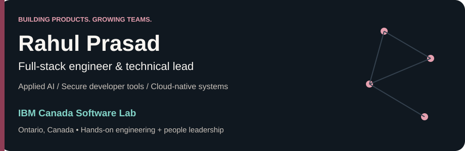
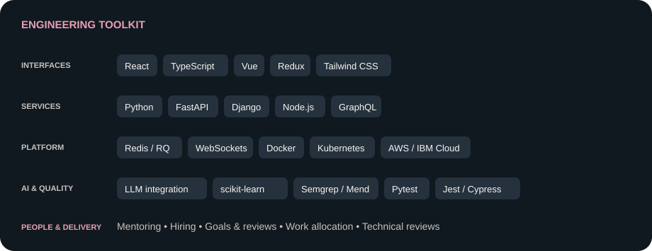
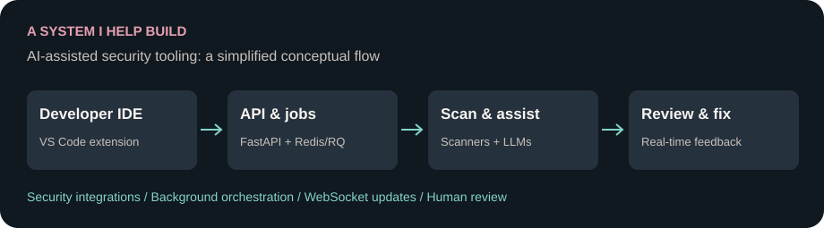
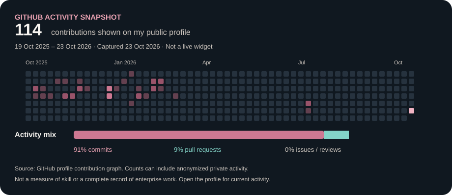

  

  <a href="https://myportfolio-3eo.pages.dev/"><strong>Portfolio ↗</strong></a> &nbsp; • &nbsp;
  <a href="https://www.linkedin.com/in/rahulprasadns/"><strong>LinkedIn ↗</strong></a> &nbsp; • &nbsp;
  <a href="https://rahulprasadns.medium.com"><strong>Writing ↗</strong></a> &nbsp; • &nbsp;
  <a href="mailto:rahulnagumantri@live.com"><strong>Let's connect ↗</strong></a>

I turn complex workflows into useful software — and help the people building it grow.

<table>
<tr>
<td width="33%" align="center"><h3>Build</h3>React & TypeScript interfaces Python services & APIs</td>
<td width="33%" align="center"><h3>Connect</h3>AI-assisted developer tools Cloud-native delivery</td>
<td width="33%" align="center"><h3>Lead</h3>Direct-report management Mentoring & technical reviews</td>
</tr>
</table>

At **IBM Canada Software Lab**, I work as a **Full Stack Developer**, combining technical leadership and direct people management with hands-on engineering. Across IBM and HCL, I have managed **5–10-person teams** and participated in interviewing and hiring **seven team members**.

## Engineering, at a glance

<strong>More tools I work with</strong>

 
PostgreSQL · MySQL · MongoDB · Terraform · GitHub Actions · GitLab CI/CD · Jenkins · Llama · Granite · TensorFlow · PyTorch · HTML · CSS

## From architecture to a working product

<table>
<tr>
<td width="50%" valign="top">
<h3>IBM · Secure developer tools</h3>

Security-scanner integration, LLM-assisted code fixes and real-time feedback inside the developer workflow.

<code>FastAPI</code> <code>Redis / RQ</code> <code>WebSockets</code>

<a href="https://myportfolio-3eo.pages.dev/projects/shift-left-security-extension/"><strong>Explore the architecture →</strong></a>
</td>
<td width="50%" valign="top">
<h3>HCL · Network infrastructure</h3>

Full-stack dashboards, service boundaries and API contracts, delivered with hands-on team leadership.

<code>React</code> <code>Django</code> <code>Microservices</code>

<a href="https://myportfolio-3eo.pages.dev/projects/network-infrastructure-dashboard/"><strong>Explore the delivery story →</strong></a>
</td>
</tr>
</table>

<strong>Earlier at Kony / Temenos:</strong> cross-platform banking applications, reusable components and developer-productivity tooling. <a href="https://myportfolio-3eo.pages.dev/projects/cross-platform-banking-suite/">Read the case study →</a>

## Open the code

<table>
<tr>
<td width="50%" valign="top">
<h3>01 / Insportify</h3>

Academic prototype for events, venues and availability. Not production-ready.

<code>Python</code> <code>Django</code>

<a href="https://github.com/rahulprasadns/Insportify"><strong>Explore repository →</strong></a>
</td>
<td width="50%" valign="top">
<h3>02 / Malicious URL Finder</h3>

URL feature extraction and model-backed API predictions.

<code>Python</code> <code>Flask</code> <code>scikit-learn</code>

<a href="https://github.com/rahulprasadns/Malicious-URL-Finder"><strong>Explore repository →</strong></a>
</td>
</tr>
<tr>
<td width="50%" valign="top">
<h3>03 / Dog Breed Classifier</h3>

Image preprocessing and inference behind an upload interface.

<code>Flask</code> <code>TensorFlow / Keras</code>

<a href="https://github.com/rahulprasadns/dog-breed"><strong>Explore repository →</strong></a>
</td>
<td width="50%" valign="top">
<h3>04 / Capstone Application</h3>

Frontend/backend integration and conversational workflows.

<code>React</code> <code>Material UI</code> <code>Flask</code>

<a href="https://github.com/rahulprasadns/Capstone2"><strong>Explore repository →</strong></a>
</td>
</tr>
</table>

Public project examples, separate from the proprietary enterprise systems above. Repository content is not a claim of sole authorship or production scale.

## Activity, not vanity metrics

A dated snapshot of GitHub's publicly displayed graph, including any anonymized private activity GitHub shows. [Current activity](https://github.com/rahulprasadns?tab=overview) · [Snapshot data](assets/activity-data.json). Enterprise work is not fully represented here.

<strong>Background, recognition & beyond the code</strong>

 

**Journey:** Kony / Temenos → WeSecureApp → Durham College AI Hub → HCL Tech → IBM Canada Software Lab.

**Education:** Postgraduate Certificate in Artificial Intelligence Design and Implementation, Durham College; B.Tech in Computer Science and Engineering, JNTU Kakinada.

**Recognition:** IBM Outstanding Technical Achievement Award; customer appreciations at HCL; Spot Awards and a Technological Excellence Award at Kony / Temenos.

**Beyond engineering:** photography, visual design, gadgets, tutorials and technical writing.

<strong>Practical AI. Thoughtful systems. Stronger teams.</strong> <a href="https://myportfolio-3eo.pages.dev/">See the portfolio →</a>

