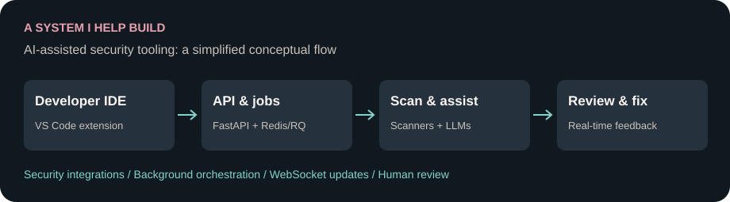

# Rahul Prasad

**Full-stack engineer and technical lead · Developer tooling, applied AI, and cloud-native systems**

At IBM Canada Software Lab, I build tools that bring security feedback into developers’ editors. I work across the UI, APIs, and background jobs, and I manage and mentor engineers. Across IBM and HCL, I’ve managed teams of **5–10** and helped interview and hire **seven** team members.

[Portfolio](https://myportfolio-3eo.pages.dev/) · [LinkedIn](https://www.linkedin.com/in/rahulprasadns/) · [Writing](https://rahulprasadns.medium.com) · [Email](mailto:rahulnagumantri@live.com)

## Selected engineering work

### IBM · Security feedback inside VS Code

A VS Code extension brings scanner findings, AI-assisted fix suggestions, and real-time feedback into the editor. FastAPI handles requests, Redis and RQ run scans in the background, and WebSockets return updates for developers to review.

[Read the IBM case study →](https://myportfolio-3eo.pages.dev/projects/shift-left-security-extension/)

### HCL · Network infrastructure dashboards

Built full-stack dashboards with React and Django and helped define service boundaries and API contracts while leading delivery. [Read the HCL case study →](https://myportfolio-3eo.pages.dev/projects/network-infrastructure-dashboard/)

### Kony / Temenos · Cross-platform banking

Worked on cross-platform banking apps, reusable components, and tools that made development easier. [Read the banking case study →](https://myportfolio-3eo.pages.dev/projects/cross-platform-banking-suite/)

## Public code

These prototypes are separate from the enterprise work above.

- **[Malicious URL Finder](https://github.com/rahulprasadns/Malicious-URL-Finder)** — Extracts features from URLs and serves model predictions through a Flask API.
- **[Insportify](https://github.com/rahulprasadns/Insportify)** — Academic Django prototype for events, venues, and availability.
- **[Dog Breed Classifier](https://github.com/rahulprasadns/dog-breed)** — Image preprocessing and TensorFlow/Keras inference behind a Flask upload interface.
- **[Capstone Application](https://github.com/rahulprasadns/Capstone2)** — Conversational workflows with a React and Material UI frontend and a Flask backend.

## Toolkit

**Interfaces** · React, TypeScript, Vue  
**Services** · Python, FastAPI, Django, Node.js, Redis, WebSockets  
**Delivery** · Docker, Kubernetes, Terraform, GitHub Actions, AWS, IBM Cloud  
**Applied AI** · LLM integration, scikit-learn, TensorFlow, PyTorch

Background and recognition

- **Recognition** · IBM Outstanding Technical Achievement Award, customer appreciations at HCL, and Spot Awards and a Technological Excellence Award at Kony / Temenos.
- **Education** · Postgraduate Certificate in Artificial Intelligence Design and Implementation, Durham College. B.Tech in Computer Science and Engineering, JNTU Kakinada.

